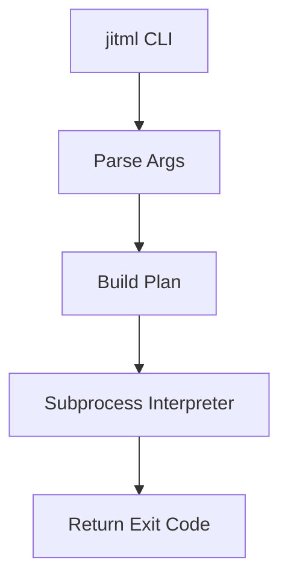

# Documentation Standards

**Status**: Authoritative source
**Canonical contracts**: documentation-standards
**Supersedes**: N/A
**Referenced by**: ../README.md, ../AGENTS.md, ../CLAUDE.md, ../DEVELOPMENT_PLAN/README.md, ../DEVELOPMENT_PLAN/development_plan_standards.md, engineering/README.md, engineering/checkpoint_format.md, engineering/numerical_core.md, engineering/determinism_contract.md, engineering/run_contract.md, engineering/product_completion_contract.md, engineering/jit_codegen_architecture.md, engineering/unit_testing_policy.md, engineering/cli_command_surface.md
**Generated sections**: documentation-standards.generated-section-index

> **Purpose**: Single source of truth for how documentation is named, structured, linked, and maintained across the jitML repository.

---

## TL;DR

Governed documents state **current implemented behavior and target contracts in
the same document**, in present-tense declarative voice, with the boundary
explicitly labeled. A target statement must never read as an already-implemented
claim. Mutable phase/sprint status, dependency order, and dated validation
evidence stay in `../DEVELOPMENT_PLAN/`, never duplicated into topic docs. Every
governed document carries a metadata block; topic docs use `**Referenced by**:`
(a curated, non-reciprocal navigation list) and root docs use `**Canonical
homes**:`. The mechanical floor is enforced by `jitml docs check` (`## Validation`).

This doctrine mirrors the family governance shape shared with
`hostbootstrap` (which jitML consumes for its host/bootstrap layer); jitML keeps
its own standard here and adds the generated-section machinery hostbootstrap does
not use.

---

## Current Status

The metadata, taxonomy, generated-section and existing status checks below are
implemented. The [ordered validation foundation](../DEVELOPMENT_PLAN/README.md#validation-foundation-refactor)
assigns current owners for the remaining catalogue, link/authority and campaign
work. [Phase 290](../DEVELOPMENT_PLAN/phase-290-ordered-plan-and-validation-foundation.md)
owns the revised status catalogue and scoped phase gates before their consumers;
this documentation change supplies no implementation or hardware evidence. The
root README remains the binding CLI/project entry contract until its explicitly
owned authority transfer is implemented and validated. Historical status details
remain in their retained plan records.

## 1. Metadata Block

Document metadata uses the metadata block below, not YAML front-matter. The
`# Title` is the first non-empty line; the purpose blockquote follows the fields.

### Governed topic documents (everything under `documents/`)

```markdown
# Document Title

**Status**: Authoritative source | Supporting reference | Draft
**Supersedes**: N/A | relative/path/to/old.md
**Referenced by**: [name](relative/link.md), [other](relative/other.md)
**Generated sections**: none | comma-separated generated-region keys

> **Purpose**: One-sentence description.
```

- All five elements are required. `**Supersedes**:` is `N/A` when nothing is
  superseded.
- `**Referenced by**:` is a **curated, non-exhaustive** ownership/navigation list
  of documents that conceptually consume this page's contract. It is **not a
  mechanically reciprocal graph**: a listed consumer need not contain a literal
  return link, and you do not manufacture a reciprocal link merely to satisfy
  metadata. Prune an entry when the named document no longer consumes the
  contract.
- `**Generated sections**:` is jitML-specific and mandatory: `none`, or the
  comma-separated `<key>` of every generated-region marker pair the file contains
  (see [§9 Generated Sections](#9-generated-sections)). `jitml docs check`
  enforces that the declared keys and the physical markers agree.
- The optional `**Canonical contracts**:` header declares comma-separated
  registered contract keys. For `documentation-standards`,
  `development-plan-standards`, `durable-state-configuration`,
  `checkpoint-storage-contract`, `product-completion-proof`,
  `training-metrics-and-splits`, `execution-resources` and
  `validation-execution`, the registered authoritative owner must declare its
  key and no other governed document may declare it. This partial registry
  does not enumerate all authority or detect unmarked claims in prose, and a
  declaration does not establish that target behavior is implemented.

### Governed root documents (`README.md`, `AGENTS.md`, `CLAUDE.md`)

```markdown
# Title

**Status**: Governed orientation document | Governed entry document
**Supersedes**: N/A | short statement of the root-level duplication this replaces
**Canonical homes**: [documents/...](documents/...), [DEVELOPMENT_PLAN/README.md](DEVELOPMENT_PLAN/README.md)
**Generated sections**: none | comma-separated generated-region keys   ← only if the root doc hosts generated regions

> **Purpose**: One-sentence description.
```

- Root docs replace `**Referenced by**:` with `**Canonical homes**:`, which points
  *outward* to the documents that own each topic the root doc summarizes.
- `README.md` uses `**Status**: Governed orientation document`; `AGENTS.md` and
  `CLAUDE.md` use `**Status**: Governed entry document`.
- Root docs summarize and link; they do not become parallel canonical homes for a
  design or engineering topic, and they carry no status ledger.
- `**Generated sections**:` appears on a root doc only when it physically hosts
  generated regions (the root `README.md` hosts the command-tree/registry
  regions); otherwise it is omitted.

### Status Values

Topic documents (closed set):

| Status | Meaning |
|--------|---------|
| `Authoritative source` | This file is the canonical home (SSoT) for its topic |
| `Supporting reference` | Index/navigation or secondary material that links to a source of truth |
| `Draft` | Not yet canonical |

Root documents (closed set):

| Status | Meaning |
|--------|---------|
| `Governed orientation document` | `README.md` — orientation layer that summarizes and links |
| `Governed entry document` | `AGENTS.md` / `CLAUDE.md` — entry rules that summarize and link |

Vague status labels (`WIP`, `Current`, `Final`) are forbidden; forward/planned
work is not a document-status concept — it lives in the plan's phase status and in
this doctrine's `## Current Status` sections.

---

## 2. Broad Doctrine Structure

Broad governed docs that define repository doctrine use stronger structure than a
short reference page:

- include `## TL;DR` or `## Executive Summary` when the topic is broad;
- include **`## Current Status`** when implemented behavior and target direction
  appear in the same document (see §3);
- include **`## Validation`** when a gate (the code-check, a test runner, or the
  doc validator) proves the contract, naming the exact command;
- use explicit tables or matrices when ownership, substrate behavior, or a model
  summary is part of the contract;
- answer directly, when relevant: what is the rule, what is current versus target,
  how is it validated;
- execution/resource doctrine names its authority boundary, actual enforcement,
  observation uncertainty, failure/retirement behavior and finite acceptance
  controls. Do not equate configured limits, a dry run or a heartbeat with
  demonstrated containment or hardware qualification.

---

## 3. Current vs Target Content Doctrine

This is the heart of the doctrine.

- **State implemented behavior and target contracts declaratively, and label the
  boundary between them.** Keep implementation chronology out of governed topic
  documents.
- A **target statement must never read as an already-implemented claim.** When a
  target conflicts with current code, the owning phase stays Active rather than the
  doc describing the unbuilt state as supported.
- When current and target mix, a **`## Current Status`** section is mandatory: it
  states, succinctly, what is implemented today versus what the owning phase(s)
  will make true, and links to the owning phase(s) in `../DEVELOPMENT_PLAN/`.
- A topic document may summarize a current defect **only as needed** to prevent its
  target contract from being mistaken for implemented behavior.
- The execution-resources and validation-execution summaries describe target
  behavior, so they begin with `**Target.**`. Their `## Current Status` sections
  separately label `**Implemented boundary.**` and `**Target.**`, with a phase
  link in the target paragraph. The scoped checker enforces these structural
  labels; it does not judge arbitrary prose or prove the cited work implemented.
- **Keep mutable phase/sprint status, dependency order, closure criteria, and dated
  implementation evidence in `../DEVELOPMENT_PLAN/`.** Topic docs carry the durable
  contract, not a second status ledger and not dated test counts.
- **Describe one numerically executable plan.** Earlier-phase validation depends
  only on that phase and completed earlier work. Later phases extend accepted
  contracts without contradicting them or adding retrospective gates. A newly
  discovered prerequisite is moved earlier or the plan is reordered explicitly;
  a genuine defect reopens its actual owner with affected evidence identified.
  Each phase requires Linux CPU and at most one additional specific OS/device
  set. The full rules and ownership-transfer requirements live in
  [plan standards rule M](../DEVELOPMENT_PLAN/development_plan_standards.md#m-forward-only-single-accelerator-numerically-ordered-phases).

WRONG/RIGHT (a WRONG example is always paired with the reason):

- WRONG: "The checkpoint wire is one self-describing envelope." — reads as
  implemented while V1/V2/V3 still ship. RIGHT: under `## Current Status`, "Today
  the wire carries V1/V2/V3 envelopes; Phase `235` collapses them to one
  self-describing envelope (target)."

---

## 4. Source of Truth and Authority Boundaries

- `../DEVELOPMENT_PLAN/README.md` owns phase order, current implementation status,
  closure criteria, and is the single cross-phase status source of truth.
- `documents/` owns architecture and engineering guidance (the durable contract).
- `README.md` is a governed orientation layer and points to canonical documents
  instead of duplicating them; `AGENTS.md` and `CLAUDE.md` are governed entry
  documents that stay aligned with the repository rules they summarize.
- When current-state or closure claims in `documents/` conflict with
  `../DEVELOPMENT_PLAN/`, reconcile the governed docs to the plan; `documents/` is
  never a parallel implementation-status authority.
- Exact test counts and real-run results are dated validation evidence owned by the
  sprint whose gate produced them, never a second "current suite" status in a topic
  or orientation doc.
- jitML **consumes** `hostbootstrap` for its host/bootstrap layer; this standard
  links to that repository for the bootstrap contract rather than re-owning it.
- An authority transfer is explicit: old section/anchor, canonical successor,
  affected consumers, current/target boundary and validation. Root CLI contracts
  remain binding until their consumers and root links change together. When the
  authorized edit scope excludes root/source files, retain that migration as an
  unmet obligation of Phase `3`, rather than claim the transfer implemented.
- [Execution resources](engineering/execution_resources.md) owns whole-host
  admission and measurement semantics; [validation execution](engineering/validation_execution.md)
  owns durable campaign execution. [Run contract](engineering/run_contract.md)
  retains typed evidence and production admission. Topic consumers link those
  owners rather than restating configuration values or maintaining parallel
  execution rules.
- Cross-project contracts require a real canonical source and a named ownership
  boundary. A missing document, unverified lock design or personal host script
  cannot be cited as implemented resource enforcement. The Windows psmux lesson
  is observer accounting/isolation, not a jitML Windows acceptance lane.

---

## 5. Taxonomy

The canonical documentation root is `documents/`. Its current top-level categories:

```text
documents/
├── README.md
├── documentation_standards.md
├── cli/            # generated CLI reference surface
└── engineering/    # architecture, design decisions, verification boundaries
```

Rules:

- `documents/` is the only canonical documentation root; a `docs/` directory is
  **not** introduced.
- The allowed top-level categories are `cli` and `engineering`. `architecture`,
  `operations`, and `research` are reserved names for future categories and may be
  added only in the same change that creates the directory and updates this file
  and `documents/README.md`.
- CLI docs under `cli/` are generated (command schema, tables, manpages,
  completion scripts) and are owned by the tracked-generated-paths registry.

---

## 6. Naming and Linking

- File names under `documents/` are lowercase `snake_case` with a `.md` suffix.
  Only `README.md` is exempt from the case rule; `AGENTS.md`, `CLAUDE.md`, and
  `LICENSE` are the permitted ALL-CAPS root names.
- Relative Markdown links are required for in-repo references; use deep links with
  section anchors, e.g.
  `./engineering/determinism_contract.md#per-substrate-floating-point-semantics`.
- Each governed doc links to at least one other governed source.
- Every relative Markdown link and anchor resolves to the intended retained
  document/section. New checker controls cover missing files, missing anchors,
  absent canonical owners and conflicting authority. Sprint `3.2` owns this
  stronger target; existing metadata checks alone do not prove it.
- Fragment checks recognize explicit `id` attributes and named anchors in
  retained HTML and SVG files. Unsupported document formats fail closed;
  this does not establish browser rendering or PDF fragment support.
- Heading-fragment checking uses the checked-in `github-slugger` 2.0.0 tables
  generated with Node 22.16.0 / Unicode 16.0 by
  [`generate-github-slug-data.mjs`](../bootstrap/generate-github-slug-data.mjs).
  The source check pins the generated table's digest. The generator requires the
  exact hash-verified upstream input; neither the runtime checker nor native
  substrate tests require Node. This reference is versioned and is not proof of
  parity with every present or future GitHub renderer.
- Module names, commands, paths, types, and binaries use backticks.
- **Version-controlled paths stay Windows-portable.** Every path that Git tracks
  (or would track, because it is not ignored) is at most **160** characters
  repo-relative, has no component longer than **100** characters, uses none of
  `< > : " \ | ? *` or control characters, has no component ending in a dot or a
  space, uses no reserved Windows device name (`CON`, `PRN`, `AUX`, `NUL`,
  `COM1`-`COM9`, `LPT1`-`LPT9`, with or without an extension), and differs from
  every other path by more than letter case. Windows `MAX_PATH` is 260 characters
  including the drive, the checkout directory and a terminating NUL, so 160
  leaves 99 characters for the checkout prefix; checkout must never depend on
  `core.longpaths`. Content-addressed or hash-named data does not repeat a full
  digest in several directory levels; a layout that cannot meet the limit is not
  version controlled and stays under ignored `.build/` or the data/cache homes.
  Docs never link to files that Git does not track. The owner of the rule and its
  rationale is
  [../DEVELOPMENT_PLAN/development_plan_standards.md](../DEVELOPMENT_PLAN/development_plan_standards.md#p-windows-portable-version-controlled-paths);
  `bootstrap/check-path-lengths.sh` checks tracked and unignored paths only;
  it does not inspect ignored generated outputs.
- **Generated paths have an explicit portability boundary.** The target is to
  inventory build, data, cache, test, download and runtime outputs, including
  ignored files, and distinguish Windows-host or host-mounted paths from paths
  confined to a Linux filesystem. Windows-exposed outputs must fit the actual
  declared checkout/output-root budget, including the root and terminator, and
  obey Windows component and name rules without requiring long-path opt-in.
  Document supported root lengths and fail clearly when a chosen root or an
  uncontrollable tool exceeds its budget; do not imply that all possible user
  roots or arbitrary external datasets fit. This is an unvalidated target owned
  by [Sprint 3.2](../DEVELOPMENT_PLAN/phase-3-governed-document-metadata-enforcement.md);
  an ignored path is not itself evidence of portability.
- **Never copy** configuration, source snippets, doctrine text, or the typed
  run-plan / delivery / lifecycle / evidence / journal shapes between docs — cite
  the owner (e.g. [engineering/run_contract.md](engineering/run_contract.md)) by
  section name/anchor. The `DEVELOPMENT_PLAN/` phase suite defines its own internal
  naming under
  [../DEVELOPMENT_PLAN/development_plan_standards.md](../DEVELOPMENT_PLAN/development_plan_standards.md).

---

## 7. Code Examples

- Always specify the language fence, and put a source-path comment on the first
  line (`-- File: src/JitML/...`) or an `-- Example:` marker for teaching snippets.
- **Current-surface examples only**: code examples must not use removed paths,
  deprecated CLI flags, unsupported toolchains/bridge layers, or stale commands
  that bypass the public `jitml` surface. A renamed/removed surface is pointed at
  [../DEVELOPMENT_PLAN/legacy-tracking-for-deletion.md](../DEVELOPMENT_PLAN/legacy-tracking-for-deletion.md),
  not shown as usable.

---

## 8. Mermaid Diagram Standards

Allowed: `flowchart TB`, `flowchart LR`, `graph TB`, `graph LR`, `stateDiagram-v2`.
Forbidden: dotted lines (`-.->`), subgraphs, complex nesting.



---

## 9. Generated Sections

jitML owns a generated-section machinery hostbootstrap does not use; it stays.
The README is the authoritative source for the generated artifact surface; this
section records the local marker conventions, paired check/write commands, and
drift enforcement.

### Marker Conventions

Generated sections are delimited by paired sentinel comments; the marker key is
dotted, hierarchical, and unique across the `GeneratedSectionRule` registry. The
current implementation supports Markdown HTML comments only:

| File type | Start marker | End marker |
|-----------|--------------|------------|
| Markdown | `<!-- jitml:<key>:start -->` | `<!-- jitml:<key>:end -->` |

Do not add non-Markdown host-syntax sentinels until `JitML.Generated.Registry` and
`JitML.Docs.Check` support writing and checking that syntax. Marker text inside
inline code, tables, or fenced examples is documentation, not a generated region.

### Authoritative List of Files with Generated Regions

The single source of truth is the in-code `GeneratedSectionRule` registry consumed
by `jitml docs check` and `jitml docs generate`. Every file that contains markers
must declare its keys in its `**Generated sections**:` metadata field (§1).

The currently scheduled registry entries:

<!-- jitml:documentation-standards.generated-section-index:start -->
| Generation target | Marker key prefix | Owning sprint |
|-------------------|-------------------|---------------|
| Root README command tree and command registry | `command-tree`, `command-registry` | Sprint 1.2 / Sprint 1.3 |
| CLI command reference | `cli-commands.reference`, `cli-commands.help-blocks` | Sprint 1.2 / Sprint 1.3 |
| Generated section index in this file | `documentation-standards.generated-section-index` | Sprint 1.3 |
| Cluster route table | `cluster.routes` | Sprint 3.4 |
| Numerical-core catalog tables | `numerics.layers`, `numerics.activations`, `numerics.spectral`, `numerics.optimizers`, `numerics.schedulers`, `numerics.losses` | Sprint 6.1 / 6.2 / 6.3 / 6.4 / 6.5 / 6.6 |
| Daemon endpoint and config table | `daemon.surface` | Sprint 5.3 |
| RL algorithm catalog table | `training.rl.catalog` | Sprint 9.3 |
| Hyperparameter tuning tables | `training.tune.samplers`, `training.tune.schedulers`, `training.tune.pruners` | Sprint 9.7 |
| PureScript contract file | `web.contracts.purescript` | Sprint 11.2 |
| Chart HTTPRoutes | `chart.routes.*` | Sprint 3.4 |
| Grafana dashboard ConfigMaps | `chart.grafana.*` | Sprint 4.5 |
| Prometheus scrape config | `chart.prometheus.scrape` | Sprint 4.5 |
| Cross-language types (TypeScript / PureScript mirrors of Haskell ADTs) | `cross-language-types.*` | Sprint 11.2 |
<!-- jitml:documentation-standards.generated-section-index:end -->

### How to Regenerate

Run `jitml docs generate` to splice the current renderer output between every
marker pair declared in the registry. Hand edits between markers are reverted on
the next regenerate and fail `jitml docs check` until reverted. On drift the check
emits the file path, the marker key, and the remedy `` Run `jitml docs generate` to
update. ``

### How to Add a New Generated Section

1. Define or extend the renderer under `src/JitML/Generated/` (or
   `src/JitML/Docs/Render.hs`).
2. Add the Markdown marker pair to the target file, or add a whole-file artifact to
   the tracked-generated-paths registry when the target is not Markdown.
3. Register a `GeneratedSectionRule` / `TrackedGeneratedPath` in
   `src/JitML/Generated/Registry.hs` or `src/JitML/Generated/Paths.hs`.
4. Run `jitml docs generate` to populate the section.
5. Confirm `jitml docs check` passes; run `jitml test` / `cabal test`, and style +
   code-quality separately with container-only `jitml lint *` / `jitml check-code`.

### Fully Generated, Do-Not-Hand-Edit Paths

The `trackingGeneratedPaths` registry in `src/JitML/Generated/Paths.hs` is the
authoritative source for whole-file generated artifacts; `jitml docs check` refuses
drift on them:

- `documents/cli/commands.md`
- `share/man/man1/jitml.1`
- `share/completion/bash/jitml`, `share/completion/zsh/_jitml`, `share/completion/fish/jitml.fish`
- `web/src/Generated/Contracts.purs`
- `chart/templates/httproute-*.yaml`, `chart/templates/grafana-dashboard-*.yaml`, `chart/templates/prometheus-scrapeconfig-jitml.yaml`

---

## 10. Brevity

If a governed document grows past roughly 300 lines, ask whether it should split.
Two focused documents are easier to skim than one combined one.

---

## 11. Update Rules

Keep the owning doc and the affected phase document changing together:

- when the checkpoint wire, admission, or supervised runtime changes, update
  [engineering/checkpoint_format.md](engineering/checkpoint_format.md) (and the
  determinism/JIT docs it deep-links) and the affected phase document in the same
  change;
- when the numerical core / layer catalog changes, update
  [engineering/numerical_core.md](engineering/numerical_core.md) and the affected
  phase document;
- when the public `jitml` CLI surface changes, regenerate
  [cli/commands.md](cli/commands.md) and update
  [engineering/cli_command_surface.md](engineering/cli_command_surface.md);
- when the run/protocol/evidence contract changes, update
  [engineering/run_contract.md](engineering/run_contract.md) and the affected phase
  document;
- when repository-level workflow rules change, review `README.md`, `AGENTS.md`, and
  `CLAUDE.md` in the same change.

---

## 12. Anti-Patterns

- Vague status labels (`WIP`, `Current`, `Final`) — use the closed Status enums (§1).
- Copy-pasted config, source, doctrine text, or typed contract shapes — link the
  owner instead (§6).
- Examples pointing at removed/renamed paths presented as usable — point at the
  legacy-tracking record (§7).
- A parallel status ledger, dated test counts, or migration chronology inside a
  topic or orientation doc — that belongs in `../DEVELOPMENT_PLAN/` (§3, §4).
- A target statement phrased as an implemented claim (§3).
- A manufactured reciprocal backlink added only to satisfy `**Referenced by**:` (§1).
- YAML front-matter, or a `docs/` directory (§1, §5).
- A tracked path over the Windows limits, a link to an untracked or ignored file,
  or reliance on `core.longpaths` (§6).

---

## 13. Validation

The mechanical documentation floor is the `JitML.Docs.Check` module
(`src/JitML/Docs/Check.hs`), run by `jitml docs check` and the `jitml lint docs`
target, and exercised by `test/unit/Main.hs`. It verifies:

- required metadata lines for governed topic documents
  (`Status`/`Supersedes`/`Referenced by`/`Generated sections`/purpose);
- required metadata lines for governed **root** documents
  (`Status`/`Supersedes`/`Canonical homes`/purpose), for `README.md`, `AGENTS.md`,
  and `CLAUDE.md`;
- generated-section marker/metadata reconciliation and whole-file
  tracked-generated-path integrity;
- Windows path portability of every tracked or unignored path
  (`bootstrap/check-path-lengths.sh`; run it before closing any change that adds
  or renames files). The `sh`/`awk` guard uses Python 3 for conservative Unicode
  case checks when available and otherwise fails closed on non-ASCII paths;
- the closure-claim scan (`src/JitML/Lint/Docs.hs`): governed docs must not assert
  current product closure (`production ready`, `all phases done`, `no-caveat product
  complete`, …) unless the evidence-derived `ClosureVerdict` is closed — dated
  historical evidence and prohibitions are exempt when their block names them as
  such. The verdict is projected from committed validation evidence, never from a
  status literal or from what a document says (see the status projection below),
  and its constructors are private to the projection, so no caller can write a
  closed verdict down;
- the **status projection** (`src/JitML/Product/PhaseStatus.hs`,
  `StatusEvidence.hs`, `StatusLoader.hs`): every product sprint is either a
  frozen, shrink-only legacy attestation that cites a closure section of its phase
  document, or owns obligations (gate transcripts, pinned lane journals, the
  three-lane aggregate, absence of pending production controls, external
  prerequisites) that must be proven by committed evidence. `docs check` compares
  each phase document with the derived status: a header that says Done without
  proof (`status-projection.<sprint>`), proof that outruns a non-Done header
  (`status-projection.<sprint>`), a Blocked sprint whose `**Blocked by**:` line
  omits an unproven upstream sprint, and any violated structure rule
  (`plan-structure.<sprint>.<rule>`: bare-word `**Status**:` agreeing with the
  heading and `## Phase State`, the currently implemented numeric-forward
  Blocked-by edges that the catalogue also lists, a Blocked-by line for Blocked and none for Planned or Done, a
  non-empty `### Remaining Work` for Active, a concrete `### Validation` gate that
  never names both accelerators, and every `jitml test <stanza> --<substrate>` the
  Validation block of an evidenced sprint runs being one of that sprint's
  gate-transcript obligations) are drifts, and so is a plan document from Phase
  `220` on that the catalogue does not list (`status-catalogue.unregistered-phase-<n>`),
  which would otherwise let a phase leave every closure verdict. The target
  checker covers the current ordered execution catalogue and its complete
  obligation-transfer register, preserves the source and scope of historical
  phase evidence, and requires dependencies and validation inputs to follow
  numerical phase/sprint order. It projects new engineering and campaign
  obligations without requiring future qualifying objects for earlier gates.
  [Phase 290](../DEVELOPMENT_PLAN/phase-290-ordered-plan-and-validation-foundation.md)
  owns the implementation and scoped validation of these extensions before
  their first consumer. This documentation refactor
  does not claim the source catalogue already implements the revised plan.
  `jitml docs status`
  prints the derived tally, the open chain, and every unmet obligation with its
  evidence pointer. `docs check` and `check-code` are computed when they run and are
  never attested by a file;
- the thin `## Closure Status` section of `DEVELOPMENT_PLAN/README.md`
  (development-plan standards rule N): its length is capped by the single constant
  `closureStatusLineCap` in `src/JitML/Product/PlanDoc.hs` (`Nothing` disables the
  check; it is `Just 60` since the README narrative moved to its historical diary
  on 2026-09-30);
- the canonical `documents/` taxonomy (top-level categories ∈ `cli`, `engineering`)
  and lowercase `snake_case` naming under `documents/` (`README.md` exempt).

`**Referenced by**:` existence is checked; **backlink reciprocity is deliberately
not enforced** (§1). Full relative-link/anchor and canonical-authority checks
are target work of Phase `3`, not a claimed property of the current checker.
Run `jitml docs check` after any governed-doc edit; run
`jitml check-code` for the Haskell quality gate and `jitml test jitml-unit
--linux-cpu` for the doc-validator tests.

---

## Cross-References

- [Engineering docs index](./engineering/README.md)
- [Development Plan](../DEVELOPMENT_PLAN/README.md) — phase order, status, closure
- [README.md](../README.md) — project orientation and CLI doctrine
- [CLAUDE.md](../CLAUDE.md), [AGENTS.md](../AGENTS.md) — governed entry documents
